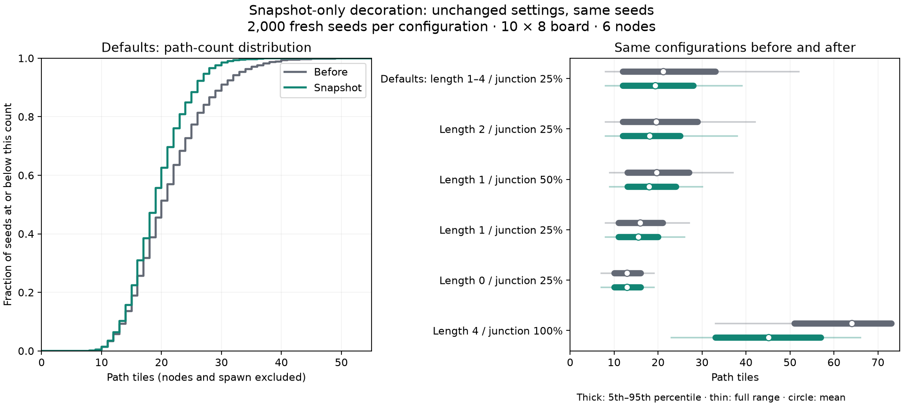

# Snapshot decoration: algorithm comparison

Baseline: `57d8de3` on `feat/hex-paths`. That commit preserves the dev screen,
warning/reviewer fixes, measurement tool, and [original study](hex-path-counts.md).
This follow-up changes only decoration candidate selection and adds a regression
test. Settings, defaults, placement, backbone routing, and branch growth are
unchanged.

## Change

Decoration captures the two-spoke path tiles present at the start of the pass,
in the existing grid order. Each candidate is rechecked before branching because
an earlier branch might already have joined it and filled its third spoke.
Newly created branch tiles cannot become new branch origins during this pass.
Paths added by the preceding spawn-minimum phase remain eligible.

This removes the feedback in which a branch could create more opportunities to
grow branches simply by extending into cells later in the grid scan.

## Results with unchanged defaults

The same 2,000 validation seeds (1,000,000–1,001,999) were compared before and
after. Path count excludes nodes and spawn, matching the panel statistics.

| Metric | Before | Snapshot |
| --- | ---: | ---: |
| Average path tiles | 21.18 | 19.29 |
| Population standard deviation | 6.48 | 4.81 |
| Standard deviation / mean (CV) | 30.6% | 24.9% |
| Median | 20 | 19 |
| 5th–95th percentile | 12–33 | 12–28 |
| Full observed range | 8–52 | 8–39 |
| Generation failures | 0 | 0 |

**Standard deviation fell by 25.8%.** The middle-90% interval narrowed by 23.8%,
and average density fell by 9.0%. Relative spread also improved, so the lower
absolute spread is accompanied by better consistency relative to density.
A paired bootstrap over these seeds (2,000 resamples, RNG seed 20261009) gives an
approximate 95% percentile interval of **23.4%–28.2%** for the SD reduction.
This estimates sampling uncertainty; it does not guarantee future board counts.

For individual paired seeds, 44.45% produced fewer path tiles, 50.10% the same
count, and 5.45% more. Once branching decisions diverge, later RNG draws also
diverge, so removing feedback does not imply that every individual seed shrinks.



[Vector plot](hex-path-counts/snapshot-distribution.svg) ·
[All before/after summaries](hex-path-counts/snapshot-comparison.csv)

## Repeated sweep

The original 66 configurations were rerun over the same seeds 0–999, followed by
the same six validation configurations over the 2,000 seeds above. All **78,000
new boards succeeded**, as did the original 78,000 boards. The default-setting SD
reduction in the initial sweep was 23.6%, consistent with the validation result.
No new settings were selected or changed for this comparison.

| Validation configuration | Mean before → after | SD before → after | SD reduction |
| --- | --- | --- | ---: |
| Defaults: length 1–4, junction 0.25 | 21.18 → 19.29 | 6.48 → 4.81 | 25.8% |
| Fixed length 2, junction 0.25 | 19.51 → 18.10 | 5.13 → 4.03 | 21.5% |
| Fixed length 1, junction 0.5 | 19.64 → 17.93 | 4.17 → 3.31 | 20.8% |
| Fixed length 1, junction 0.25 | 15.90 → 15.53 | 3.02 → 2.79 | 7.3% |
| Fixed length 0, junction 0.25 | 12.92 → 12.92 | 2.01 → 2.01 | 0.0% |
| Fixed length 4, junction 1 | 64.04 → 45.12 | 6.99 → 7.07 | −1.2% |

Length zero creates no new branch tiles, and every paired count is unchanged.
The formerly near-saturated dense configuration loses substantial density but
has slightly higher SD. The change therefore improves default-setting spread
without establishing a universal improvement across settings.

## Remaining variation

The default spread is meaningfully narrower, but **8–39 is still a broad observed
range**. Candidate count depends on backbone size; each candidate independently
rolls for a junction; branch lengths vary; and obstacles can truncate growth.
Snapshotting removes amplification without imposing a path-count target.

If a much tighter range is required, the next algorithm decision is whether to
allocate a controlled number of added path tiles during decoration. That would
need rules for boards where the requested allocation cannot fit. This study
does not add such a budget or adjust any settings.

## Reproduce the new samples

Run from the org root, using the local workspace target directory. Baseline
samples were captured before this change, at `57d8de3`; the original summaries
and plots remain in that commit. Raw samples for both versions are retained in
`tmp/hex-paths-measure/`.

```sh
cargo run --offline -p quell --example hex_paths_measure -- 1000 0 \
  > tmp/hex-paths-measure/snapshot-sweep.csv
cargo run --offline -p quell --example hex_paths_measure -- 2000 1000000 \
  default,length_0,length_1,length_2,j0.5_len1_n2,j1_len4_n2 \
  > tmp/hex-paths-measure/snapshot-holdout.csv
```

Both versions use the same dependency lockfile and case definitions. Percentiles
use sorted index `floor(p × (n − 1))`; bootstrap samples preserve the before/after
pair for each selected seed. The regression test uses open space, forced
junctions, and length-one branches to verify that new branch tiles never sprout
another branch during decoration. Existing tests continue to check connectivity,
spoke caps, placement, deck counts, and repeatability within the new generator.
The regression was checked against both versions: the baseline creates four path
tiles and fails the expected-two-tiles assertion; snapshot decoration creates two
and passes.
