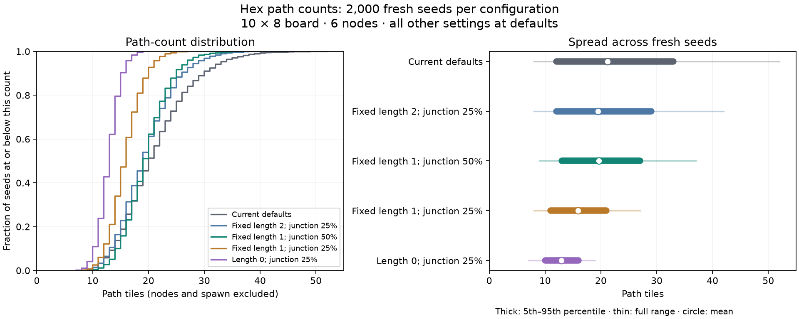

# Hex path counts across seeds

Measured on 2026-10-09 with the production generator from `b094306`, using
`examples/hex_paths_measure.rs` and the current workspace lockfile. The generator
and its defaults were unchanged during this study.

The strongest tested option near the current density is **fixed branch length 1
and junction chance 0.5**. On fresh seeds it reduces standard deviation by 35.6%
while producing 7.3% fewer path tiles on average. It also produces more junctions:
about 10.3 three-spoke tiles per board instead of 6.7. This changes the board's
character toward short, frequent branches.

## Method

- Count `TileKind::Path` tiles, excluding the six nodes and spawn. This matches
  the panel's two-spoke plus three-spoke counts, rather than counting routes.
- Keep the default 10 × 8 board, six-node deck, spacing, and centered spawn.
  Change only the settings named by each case.
- Sweep 66 configurations over seeds 0–999: noise, junction chance, fixed branch
  lengths, join chance, shape weights, spawn placement/spokes, and combinations
  of noise, junction chance, and fixed branch length.
- Select promising configurations from that sweep. Compare six configurations
  over a separate set of 2,000 seeds, 1,000,000–1,001,999, shared by all six cases.
- Keep generation failures in the sample counts. There were **no failures in
  78,000 generated boards**. This does not establish success for other settings.
- Use population standard deviation. CV is standard deviation divided by mean,
  allowing comparison across different densities. Percentiles use sorted index
  `floor(p × (n − 1))`. They describe this sample, not guaranteed bounds.

## Fresh-seed results

All unnamed settings remain at their defaults, including noise 2 and join chance
0.3. Fixed length means setting both minimum and maximum to that length.

| Configuration | Mean paths | Standard deviation | CV | 5th–95th percentile | Full range |
| --- | ---: | ---: | ---: | --- | --- |
| Current defaults: length 1–4, junction 0.25 | 21.18 | 6.48 | 30.6% | 12–33 | 8–52 |
| Fixed length 2, junction 0.25 | 19.52 | 5.13 | 26.3% | 12–29 | 8–42 |
| **Fixed length 1, junction 0.5** | **19.64** | **4.17** | **21.2%** | **13–27** | **9–37** |
| Fixed length 1, junction 0.25 | 15.90 | 3.02 | 19.0% | 11–21 | 8–27 |
| Fixed length 0, junction 0.25 | 12.92 | 2.01 | 15.6% | 10–16 | 7–19 |
| Fixed length 4, junction 1 | 64.04 | 6.99 | 10.9% | 51–73 | 33–73 |



[Vector plot](hex-path-counts/distribution.svg) ·
[Complete sweep and fresh-seed summaries](hex-path-counts/summary.csv)

## What drives the spread

Longer side branches have a strong effect. In the initial sweep, fixed length 1
had standard deviation 3.08; length 4 had 9.16; length 6 had 11.64. Changing noise,
shape preferences, or join chance individually did little to improve consistency
near the current density.

The decoration pass scans cells in grid order and checks the current tiles as it
goes. A branch created in an unvisited cell can later become a junction and grow
another branch in the same pass. This is a mechanism that can amplify differences
between seeds; the measurements above do not isolate its contribution from branch
length, placement, and routing. The fixed-length-zero case adds no branch tiles
and still varies by about two tiles in standard deviation.

The dense option has a low CV because it approaches the board's capacity of 73
path cells. Its absolute standard deviation exceeds the defaults, and it fills
about 88% of the available cells on average. It suits a much denser board.

Try length 1 / junction 0.5 if keeping roughly the current path density is the
priority. Try length 1 / junction 0.25 if a sparser board is welcome. A guaranteed
path-count range would need a separate generator decision, such as a path budget.
No defaults have been changed based on this study.

## Reproduce

Run from the org root. Both commands use the workspace's local target directory
and do not launch the game. The optional third argument filters case names.

```sh
mkdir -p tmp/hex-paths-measure
cargo run --offline -p quell --example hex_paths_measure -- 1000 0 \
  > tmp/hex-paths-measure/sweep.csv
cargo run --offline -p quell --example hex_paths_measure -- 2000 1000000 \
  default,length_0,length_1,length_2,j0.5_len1_n2,j1_len4_n2 \
  > tmp/hex-paths-measure/holdout.csv
```

Counts depend on the generator, RNG, and dependency versions; retain the same
lockfile when comparing these results. The raw samples for this run are in
`tmp/hex-paths-measure/` at the org root.
